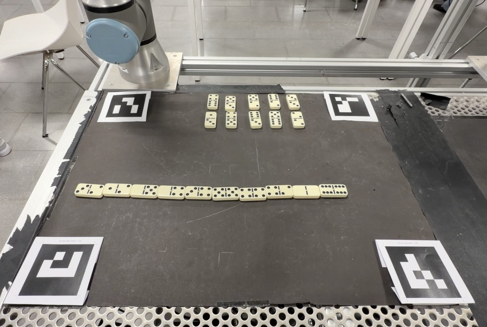

# Proyecto Final de Visión – Buscador de números en dominó

> Restricción: el sistema final usa **solo visión clásica** (OpenCV, NumPy, scikit-image, etc.). **Sin redes neuronales.** MediaPipe/YOLO/etc. solo se permiten en pruebas de concepto o como línea base de comparación.

---

## 1. Qué hay en la escena (observado en la imagen)



*Figura 1. Escena de referencia vista por la cámara.*

- Mesa oscura (fondo negro mate) → las fichas (marfil/blancas) tienen **contraste muy alto**. Esto facilita mucho la segmentación.
- **4 marcadores ArUco** en las esquinas de la mesa. Sirven para:
  - rectificar la perspectiva (homografía) a una vista cenital,
  - dar coordenadas métricas en el plano de la mesa,
  - pasar esas coordenadas al marco del robot UR (calibración automática, ver §6b).
- **Zona de juego**: una fila de 10 fichas horizontales (centro-izquierda de la imagen).
- **Zona de pool**: 10 fichas verticales en 2 filas de 5 (parte superior).
- Una ficha de la fila es **blanca (0|0)** y las fichas tienen sombras/brillos leves.
- La cámara no es perfectamente cenital: hay perspectiva visible → la homografía es obligatoria para medir bien.

## 2. Definición del problema

**Entrada:** un número `N` (0–6).

**Aplicación:** el resultado lo consume un **robot UR**, que usará la ubicación para actuar (ver "Contexto robot" abajo).

| Paso | Descripción | Salida |
|------|-------------|--------|
| 1 | Detectar fichas y leer sus dos mitades (valor 0–6 de cada una) | lista de fichas `(a, b, posición, orientación, zona)` |
| 2 | En la **zona de juego**, revisar si `N` está en alguno de los **extremos** de la fila | sí/no |
| 3 | Si sí → reportar **en qué lado** de la zona de juego está (`left` / `right`) y su ubicación exacta (px, mesa y **marco del robot**) | `side`, `robot_side`, coordenadas (ver §3) |
| 4 | Si no → reportar *"el número N no se encuentra en la partida"* y **terminar** (no se busca en el pool) | mensaje |
| 5 | En el **pool**, buscar fichas que contengan `N` en cualquiera de sus mitades; si hay varias, quedarse con **la más cercana al robot** | una ficha o *"no se encuentra"* |
| 6 | Para esa ficha, reportar su ubicación exacta (incluida en el marco del robot) y **si el `N` está arriba o abajo**, más su ángulo, para que el robot sepa **cuánto girar la pinza** | `pool.n_position` (`up`/`down`), `pool.gripper_yaw_deg`, `pool.location` (incluye `angle_deg`) |

### Contexto robot (UR)

El sistema alimenta a un **brazo UR** montado en el borde superior de la mesa (se ve arriba en la imagen). Por eso, además de detectar, el sistema debe entregar lo que el robot necesita para actuar:

- **Zona de juego:** en qué **lado** (`left` / `right`) está el número `N`, y su posición.
- **Pool:** para la ficha elegida, si el `N` está **arriba** o **abajo**, más el **ángulo de la ficha**, para calcular cuánto girar la pinza (yaw).
- **Coordenadas en el marco base del robot** (`center_robot_mm`), no solo de cámara.
- **Alcance:** por ahora el proyecto es **solo de visión**. La comunicación con el UR (más adelante, un *topic* de ROS) queda fuera; visión solo produce el JSON del §3.

> ⚠️ **Convención de ejes (crítico):** el robot está arriba de la imagen mirando hacia la mesa, así que su izquierda/derecha está **invertida** respecto a la de la cámara. Se define una sola convención y se documenta:
> - `left/right` = **vista de la cámara** (como se ve en la imagen) por defecto; se reporta también `robot_side` con la convención del robot, para evitar errores.
> - `up/down` (pool) = **arriba = lado más cercano al robot** (parte superior de la imagen rectificada), **abajo = lado más lejano**. Si la ficha está girada, se calcula con el vector del eje largo de la ficha, no con el eje de píxeles.

### Decisiones tomadas por el equipo

| # | Tema | Decisión |
|---|------|----------|
| 1 | Extremos | Solo los 2 extremos de la fila: mitad izquierda de la ficha más a la izquierda y mitad derecha de la ficha más a la derecha. |
| 2 | Coincidencia en pool | Una ficha coincide si **cualquiera** de sus dos mitades vale `N`. |
| 3 | Fichas dobles (ej. 4\|4) | Se reporta siempre `n_position = "up"` (respuesta binaria). |
| 4 | Varias coincidencias en pool | Se reporta **solo una**: la más cercana al robot. |
| 5 | `N` no está en el juego | Reportar y **terminar**; no se busca en el pool. |
| 6 | Izquierda/derecha | Se reportan ambas convenciones: `side` (cámara) y `robot_side`. |
| 7 | Arriba/abajo (pool) | Arriba = lado más cercano al robot; abajo = más lejano. |
| 8 | Giro de pinza | `gripper_yaw_deg` normalizado a [-90°, 90°]. |
| 9 | Ubicación exacta | Píxeles, mm en el plano de la mesa y XYZ en el marco del robot. **No** se entrega XYZ en marco de cámara. |
| 10 | Altura Z | Constante medida a mano (altura de mesa + mitad del grosor de la ficha). |
| 11 | Calibración mesa→robot | **Automática**: al inicio y de forma continua, usando los ArUco; se reajusta sola si la cámara se mueve. |
| 12 | Captura | Robot en pose "home" fuera de vista; solo se procesa con el robot quieto. |
| 13 | Comunicación con UR | Fuera del alcance por ahora; más adelante, un topic (ROS). |
| 14 | Zonas juego/pool | Dos regiones fijas en coordenadas de la mesa; cada ficha se asigna por su centro. |
| 15 | "Tiempo real" | **Una captura por consulta**: llega `N`, se toma un frame y se responde en ≲ 2 s. No hay video continuo. |

## 3. Formato de salida (contrato)

```json
{
  "number": 4,
  "game": {
    "found": true,
    "side": "right",
    "robot_side": "left",
    "values": [6, 4],
    "location": {
      "center_px": [1010, 830],
      "center_table_mm": [412.3, 188.0],
      "center_robot_mm": [-210.5, 330.2, 0.0],
      "angle_deg": 0.8
    }
  },
  "pool": {
    "found": true,
    "n_position": "up",
    "gripper_yaw_deg": 2.0,
    "values": [4, 2],
    "location": {
      "center_px": [1190, 450],
      "center_table_mm": [305.0, 90.5],
      "center_robot_mm": [-102.0, 250.1, 0.0],
      "angle_deg": 92.0
    }
  },
  "message": null
}
```

Cuando hay algo que avisar, `message` es un objeto en lugar de `null`:

```json
"message": {
  "text": "Number 4 not found in the game",
  "origin": "game"
}
```

- `text`: descripción legible del aviso.
- `origin` ∈ `game | pool | calibration`: de dónde viene el aviso. `calibration` cubre el caso de menos de 3 ArUco visibles (la consulta falla con error en vez de dar coordenadas dudosas).

Estructura: dos bloques **simétricos**, `game` y `pool`. Cada uno tiene el mismo esqueleto:
- `found` (booleano): ¿se halló `N` en esa zona?
- campos propios de la zona **adentro del bloque**: `side`/`robot_side` en `game`; `n_position`/`gripper_yaw_deg` en `pool`.
- `values`: la ficha encontrada (`[a, b]`).
- `location`: mismo formato en ambos bloques (px, mesa, robot y ángulo de la ficha).

Notas:
- `n_position` ∈ `up | down`. En una ficha doble (ej. 4|4) siempre es `up`.
- `gripper_yaw_deg` = yaw que debe aplicar la pinza para alinearse con el eje largo de la ficha, normalizado a [-90°, 90°] por simetría de la pinza. `n_position` junto con `location.angle_deg` (0–360°, dirección arriba→abajo de la ficha) indica si hace falta girar 180° adicionales.
- Si hay varias fichas del pool con `N`, solo se reporta la **más cercana al robot**.

Casos sin resultado (los campos de la zona van en `null`):

| Caso | `game.found` | `pool.found` | `message` |
|------|--------------|--------------|-----------|
| `N` no está en los extremos (se termina, no se busca en el pool) | `false` | `null` (no se evaluó) | `{"text": "Number 4 not found in the game", "origin": "game"}` |
| `N` en un extremo, pero no hay ficha con `N` en el pool | `true` | `false` | `{"text": "No tile with number 4 found in the pool", "origin": "pool"}` |
| Menos de 3 ArUco visibles (falla la calibración) | `null` | `null` | `{"text": "Fewer than 3 ArUco markers visible", "origin": "calibration"}` |
| Encontrado en ambas zonas | `true` | `true` | `null` |

## 4. Pipeline técnico (todo clásico)

```
Captura (1 frame por consulta de N, robot en "home")
 └─► [A] Detección ArUco → homografía H (recalculada en cada captura) → imagen rectificada (cenital) + transformación mesa→robot
      └─► [B] Segmentación de fichas
            · gris/HSV → Otsu o umbral adaptativo (fichas claras sobre fondo oscuro)
            · morfología (open/close) → contornos
            · filtro por área y relación de aspecto ≈ 2:1
            · cv2.minAreaRect → centro, ángulo, tamaño
            · enderezar cada ficha (warpAffine) a un recorte canónico 2:1
            · dividir por la línea central → mitad 1 / mitad 2
      └─► [C] Conteo de puntos por mitad
            · dentro del recorte: umbral inverso (puntos negros sobre marfil)
            · SimpleBlobDetector o contornos + circularidad/área
            · quitar la barra central (no es punto: es alargada)
            · contar → 0..6
            · validar con patrón geométrico (rejilla 3×3 de posiciones válidas)
      └─► [D] Lógica de negocio
            · clasificar fichas en zona juego vs pool (dos regiones en coordenadas de mesa, por centro de la ficha)
            · ordenar fila de juego por eje X, identificar extremos
            · si N no está en un extremo → reportar y terminar
            · si está → lado, coordenadas; buscar en pool la ficha más cercana al robot con N
            · generar JSON + imagen con overlay de resultados (para depuración y demo)
```

### Herramientas permitidas (sugeridas)
`opencv-python` (incl. `cv2.aruco`, que es detección clásica, no una red), `numpy`, `scikit-image`, `scipy`, `matplotlib` para análisis.

## 5. División del trabajo

### Equipo de 4 personas

| Rol | Módulo | Entregables | Dificultad |
|-----|--------|-------------|-----------|
| **P1 – Geometría y calibración** | [A] | Detección ArUco, homografía, rectificación y funciones `px→mesa_mm` y **`mesa→robot`** con **calibración automática continua** (ver §6b). Calibración de la cámara (tablero de ajedrez) solo si se necesita quitar distorsión. Validación de error en mm contra medidas reales. | Alta |
| **P2 – Segmentación de fichas** | [B] | Detector de fichas robusto a iluminación/sombras. Salida: recorte enderezado + mitades + orientación. Asignar juego/pool por las regiones en coordenadas de mesa. | Media |
| **P3 – Lectura de puntos** | [C] | Contador de puntos 0–6 por mitad, manejo de ficha blanca, validación por patrón, rotación de 180° (¿cuál mitad es cuál?). Matriz de confusión. **Además:** determinar `up/down` del `N` y el ángulo/yaw de la ficha del pool (usa el eje largo de la ficha de P2). | Media-alta (es el núcleo de precisión) |
| **P4 – Lógica, integración y evaluación** | [D] + infra | Repo, CLI (`N` → captura → JSON), overlay de resultados, formato JSON, lógica de extremos (lado izq/der) y pool, dataset etiquetado a mano, métricas, demo y reporte. (La integración con el UR queda para después, ver §6b.) **Además:** PoC con red neuronal (ver §7). | Media-alta |

> Los módulos A, B y C son independientes si se acuerdan las interfaces desde el día 1 (§6), así nadie bloquea a nadie.

## 6. Interfaces entre módulos (acordar ya)

```python
# A → todos
rectify(frame) -> (warped_img, H)                     # P1
px_to_table_mm(pt_px, H) -> (x_mm, y_mm)              # P1
table_to_robot(pt_mm) -> (x, y, z)                    # P1 (calibración automática)

# B
detect_tiles(img) -> list[Tile]                       # P2
# Tile: contour, center_px, angle, size, crop_canonical (2:1), halves=(crop_a, crop_b)

# C
read_half(crop_half) -> int  # 0..6, con confianza     # P3

# D
run(frame, N) -> Report (JSON del §3)                 # P4
```

### 6b. Preparación para el robot UR

1. **Calibración mesa→robot, automática** (P1): los ArUco están fijos en la mesa, así que **una sola vez** se mide la posición de cada uno en el marco base del UR (con el TCP en freedrive, ≥ 3–4 marcadores) y se guarda en un archivo de configuración. Después, en **cada captura**, el sistema detecta los ArUco, recalcula la homografía imagen→mesa y la transformación mesa→robot (`cv2.findHomography` / Kabsch). Así, si la cámara se mueve, la calibración se corrige sola, sin intervención. Se reporta el error de reproyección de los marcadores y se avisa si supera un umbral.
2. **Altura Z**: constante medida a mano (altura de la mesa + mitad del grosor de la ficha), configurable.
3. **Orientación de pinza** (P3): del ángulo de la ficha en el plano de la mesa se obtiene `gripper_yaw_deg` en [-90°, 90°]; `n_position` (arriba/abajo) indica si hace falta un giro de 180° adicional.
4. **Comunicación con el UR: fuera de alcance por ahora.** Visión solo entrega el JSON del §3. Más adelante se publicará en un topic (ROS); al integrarlo, acordar unidades (mm vs m, grados vs radianes) y convención de ejes.
5. **Captura segura**: el brazo puede tapar los ArUco y las fichas. El robot espera en una **pose "home"** fuera de la vista de la cámara, y solo se captura con el robot quieto. Si hay < 3 ArUco visibles, la consulta falla con un error claro (en lugar de dar coordenadas dudosas).

Estructura sugerida del repo:

```
proyecto/
├── PLAN.md
├── data/            # imágenes/videos + labels.json (ground truth)
├── src/
│   ├── calibration.py   # P1
│   ├── tiles.py         # P2
│   ├── pips.py          # P3
│   ├── logic.py         # P4
│   └── main.py          # P4
├── notebooks/       # experimentos
└── poc_nn/          # solo pruebas de concepto con redes
```

## 7. ¿Y si queremos hacerlo también con redes neuronales?

Sí hay espacio, pero **como comparación, no como entrega principal**. Propuesta (a cargo de P4, o de quien termine primero):

- Detector tipo YOLO (fichas + valor de cada mitad) con un dataset propio de ~100–200 imágenes.
- Comparar contra el método clásico: precisión por mitad, tiempo de respuesta, robustez a luz.
- Esto da una sección fuerte en el reporte ("clásico vs NN") sin romper la regla.

Las **pruebas de concepto rápidas** (ej. MediaPipe, YOLO preentrenado) también sirven para validar ideas antes de implementarlas a mano, y sirven como "ground truth auxiliar" para etiquetar datos.

## 8. Fases y checkpoints

| Fase | Objetivo | Hecho cuando… |
|------|----------|----------------|
| **0. Setup** | Repo, entorno, capturar dataset (fotos/video con distintas luces y posiciones de fichas) y etiquetarlo | Existe `data/labels.json` con ≥ 20 escenas |
| **1. Módulos aislados** | A, B y C funcionando por separado sobre imágenes estáticas | Cada módulo produce la salida esperada sobre las imágenes del dataset |
| **2. Integración** | `run(frame, N)` end-to-end sobre imágenes | Reporta correctamente en todo el dataset estático |
| **3. Captura por consulta** | Flujo completo: llega `N` → se captura un frame → JSON + overlay en ≲ 2 s, con calibración automática en cada captura | Demo estable (opcional: votación sobre 3–5 frames tomados en la misma consulta) |
| **4. Evaluación y reporte** | Métricas, errores en mm, comparación con NN (opcional), informe, demo | Entregables listos |

## 9. Métricas de evaluación

- **Detección de fichas**: recall/precisión (¿se detectaron las 20?).
- **Lectura de mitades**: accuracy y matriz de confusión 0–6.
- **Decisión** ("¿está N en el extremo?", "¿en el pool?"): accuracy sobre todas las N∈0..6 por escena.
- **Localización**: error medio en px y mm (medir con regla / posiciones conocidas respecto a los ArUco), incluido el error en el marco del robot (¿llega la pinza a la ficha?).
- **Lado y orientación**: accuracy de `left/right` y de `up/down`; error angular del yaw en grados.
- **Calibración automática**: error de reproyección de los ArUco y error del marco robot tras mover la cámara a propósito.
- **Prueba de punta a punta** con el UR (cuando se integre): % de fichas tomadas con éxito.
- **Rendimiento**: tiempo de respuesta por consulta (objetivo ≲ 2 s).

## 10. Riesgos y mitigaciones

| Riesgo | Mitigación |
|--------|-----------|
| Brillos/sombras sobre las fichas rompen el umbral | Umbral adaptativo, canal V/L, ecualización local (CLAHE); fijar exposición de la cámara |
| Confundir la barra central con un punto | Filtrar por circularidad/área; excluir banda central |
| Fichas muy juntas en la fila se fusionan en un solo contorno | Transformada de distancia + watershed, o dividir por tamaño esperado (2:1) |
| Ficha blanca (0) vs. ficha mal segmentada | Validar que el recorte tenga estructura de ficha antes de decir "0" |
| Ambigüedad 180° (¿cuál mitad es izquierda?) | Definir convención en la imagen rectificada (izq→der, arriba→abajo) |
| Izquierda/derecha invertida entre cámara y robot | Reportar `side` (cámara) y `robot_side`; probar con una ficha de referencia |
| Error de calibración cámara→robot hace que la pinza falle la ficha | Validar tocando puntos de prueba; tolerancia de la pinza vs error en mm; calibración automática en cada captura con umbral de error de reproyección |
| Ficha del pool girada (no perfectamente vertical) | Usar ángulo de `minAreaRect` y reportar `gripper_yaw_deg`; no asumir vertical |
| Error de ubicación en mm | Tamaño real de los ArUco medido con precisión; promediar varios frames de la misma consulta |
| ArUco ocluido por el brazo robótico | Robot en "home" al capturar; exigir ≥ 3 marcadores visibles, o fallar con un mensaje claro |
| Lectura inestable entre frames | Votación sobre 3–5 frames tomados en la misma consulta |

## 11. Entregables finales

1. Código funcional (CLI: `N` → captura → JSON + imagen con overlay) y demo.
2. Dataset etiquetado + script de evaluación.
3. Informe: método, resultados, errores, (opcional) comparación clásico vs NN.
4. Video de demostración.

## 12. Próximos pasos inmediatos

1. Asignar los 4 roles (P1–P4).
2. ~~Confirmar los supuestos~~ → ya resueltos en la §2 ("Decisiones tomadas").
3. Medir el tamaño real de los ArUco y de una ficha (mm), anotar los IDs de cada marcador y **medir la posición de cada ArUco en el marco del robot** (una sola vez, para la calibración automática).
4. Medir la altura Z de las fichas y definir las dos regiones (juego y pool) en coordenadas de mesa.
5. Capturar el dataset inicial con variaciones de luz y de acomodo de fichas.
6. P1–P3 arrancan en paralelo con las interfaces del §6; P4 monta el repo y el dataset.
