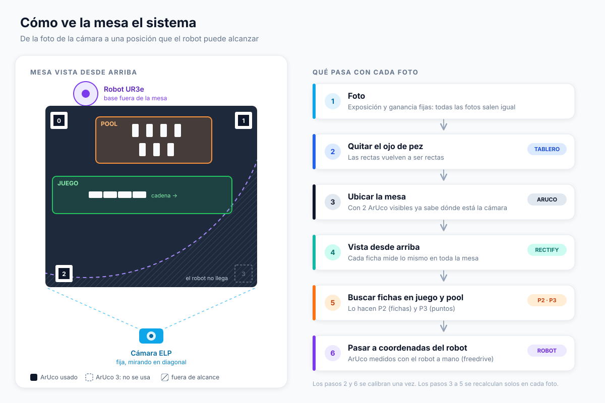

# Calibración



Dos calibraciones distintas:

- **Lente**: quita el efecto ojo de pez (las rectas salen curvas). Se hace una vez con un tablero de ajedrez.
- **Mesa**: con los ArUco se pasa de píxeles a mm de la mesa y de ahí a coordenadas del robot. Se recalcula sola en cada foto.

## TL;DR

```bash
# 1. preview: p = elegir luz · c = fotos del tablero (15-25) · a = foto de la escena
python -m scripts.camera_preview

# 2. lente: pegar en config.py lo que imprime
python -m scripts.calibrate_camera

# 3. revisar: zonas y WARP_PX_PER_MM recomendado
python -m scripts.draw_zones captures/arucos/01.png
python -m scripts.suggest_warp_scale captures/arucos/01.png
```

## Pasos

1. **Fijar la cámara.** Que se vean los ArUco 0, 1 y 2. Ajustar zoom y foco en el lente y apretar los tornillos.
2. **Luz.** En el preview, `p` hasta que la ficha blanca-blanca no se queme → `CAMERA_PRESET`.
3. **Lente.** Imprimir [el tablero](print/chessboard-9x6-20mm-a4.pdf) al 100 %. En el preview, `c` con el tablero en distintas posiciones (bordes y esquinas). Luego `calibrate_camera` → `CAMERA_MATRIX` y `DIST_COEFFS`.
4. **Escena.** En el preview, `a` con las fichas puestas.
5. **Revisar.** `draw_zones`: las zonas caen donde van las fichas. `suggest_warp_scale` → `WARP_PX_PER_MM`.
6. **Robot** (hecho). Freedrive a los ArUco → `ARUCO_ROBOT_MM` y `DOMINO_GRIP_Z_MM`.

## Cuándo repetir

- Se mueve la cámara o se tocan los anillos del lente: pasos 1, 3, 4 y 5.
- Se mueven los ArUco: paso 6 también.
- Cambia la luz: solo el paso 2.

## Para imprimir

En [`print/`](print/), siempre a tamaño real (100 %) y verificando con la regla de 100 mm de la hoja:

- `chessboard-9x6-20mm-a4.pdf`: tablero para calibrar el lente.
- `aruco-markers-a4.pdf`: los 4 ArUco de 80 mm (`aruco-markers-a4.json`: posición de cada uno en la hoja).
