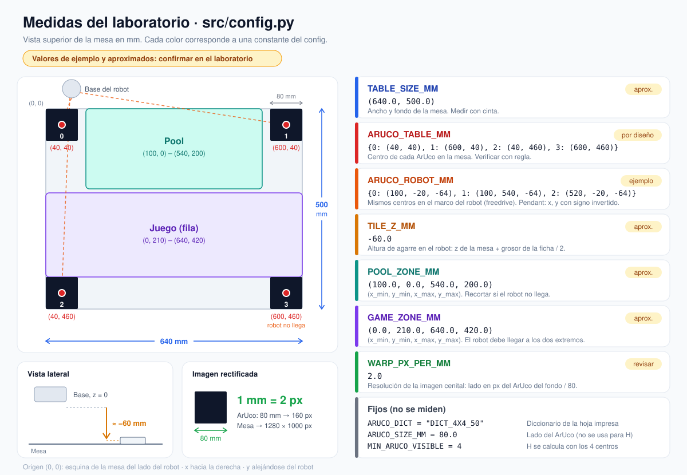

# Medidas del laboratorio

Valores de `src/config.py` que se miden o ajustan en el laboratorio. Los valores actuales son aproximados.

| Constante | Cómo se obtiene |
|---|---|
| `TABLE_SIZE_MM` | Cinta: ancho y fondo de la mesa |
| `ARUCO_TABLE_MM` | Regla: centro de cada ArUco (pegados a ras de las esquinas, orden de la hoja) |
| `ARUCO_ROBOT_MM` | Freedrive a los ArUco 0, 1 y 2 (TCP en la punta de los dedos); x, y del pendant con signo invertido |
| `TILE_Z_MM` | z de los ArUco + grosor de la ficha / 2 |
| `GAME_ZONE_MM` / `POOL_ZONE_MM` | Recortar si el robot no llega |
| `WARP_PX_PER_MM` | Lado en px de un ArUco del fondo / 80 (`python -m scripts.inspect_aruco`) |
